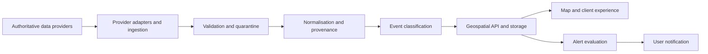

# BASTION-KERN

**A geospatial situational-awareness platform by OFFENTLOGSPOT.**  
**Product principle:** *Know what is happening. Know what to do next.*

BASTION-KERN is being developed as a mobile-first platform for understanding relevant global and local events through geographic context, source provenance, and clear operational information. Its intended domains are **Global Intelligence**, **Local Awareness**, and **Navigation**.

> **Project status:** Engineering foundation and product development in progress. This repository must not be interpreted as evidence that every described capability is implemented, continuously operating, certified, or suitable as an emergency-response service.

## Product scope

- Global and local event context, with explicit separation between the two.
- Geospatial visualisation and navigation-oriented context.
- Source-aware event records with timestamps, confidence, verification state, and lifecycle.
- Clear distinction between severity, confidence, freshness, and source authority.
- A calm, accessible, mobile-first interface.

## Engineering principles

1. **Evidence before claims.** Every operational event must retain source identity, source record reference, observation/publication times, and transformation history.
2. **No fabricated live state.** Demonstrations and fixtures must be visibly identified and isolated from production data.
3. **Fail visibly, not silently.** Delayed, unavailable, preliminary, and unconfirmed states must remain distinguishable.
4. **Privacy by design.** Collect only what a defined feature requires; minimise retention and restrict access at the server boundary.
5. **Secure by default.** No credentials, service-role keys, private datasets, or deployment secrets belong in Git.
6. **Interoperable geospatial data.** Use explicit CRS and axis-order contracts; GeoJSON positions follow RFC 7946 longitude/latitude order.
7. **Traceable changes.** Architecture decisions, provider terms, schema changes, and releases must be reviewable.

## Reference architecture

The intended data path is documented in [System architecture](docs/architecture/system-overview.md). It describes the target design and does not certify that each stage is deployed.



## Repository map

| Path | Purpose |
|---|---|
| `docs/architecture/` | System boundaries, data flow, and component responsibilities |
| `docs/data/` | Provider governance, provenance, and attribution requirements |
| `docs/security/` | Threat model and security assumptions |
| `docs/governance/` | Intellectual property and licensing policy |
| `docs/engineering/` | Roadmap and engineering controls |
| `docs/geospatial/` | CRS, GeoJSON, and coordinate contracts |
| `schemas/` | Machine-readable data contracts |
| `scripts/` | Repository validation utilities |
| `.github/workflows/` | Automated repository checks |

Start with the [documentation index](docs/README.md).

## Technology and integrations

The product's current design direction includes React/TypeScript, Mapbox geospatial rendering, and Supabase where a project is configured. The exact production stack, deployment topology, and service ownership must be confirmed against the active application and infrastructure before they are described as deployed.

- [Backend integration boundary](docs/architecture/backend-integration.md)
- [Provider and data governance](docs/data/source-governance.md)
- [Geospatial coordinate contract](docs/geospatial/coordinate-reference-systems.md)

No AWS dependency is assumed by this reference architecture. No new Supabase project or production database is created by repository documentation.

## Data and trust model

A record's **severity** is not its **verification status**. The product must preserve separate dimensions:

- Severity: informational, low, moderate, high, critical (where the source and classification model support it).
- Verification: verified, corroborated, preliminary, unconfirmed.
- Freshness: source observation time, publication time, ingestion time, and last update.
- Provenance: provider, source record ID, source URL, attribution, licence/terms reference, and transformation history.

See [source governance](docs/data/source-governance.md) and the [event schema](schemas/event.schema.json).

## Security

This is a public repository. Assume committed source, static assets, and Git history are inspectable. Never commit secrets. Report vulnerabilities privately using the process in [SECURITY.md](SECURITY.md); do not publish exploit details in an issue.

The repository's security assumptions and mitigations are recorded in the [threat model](docs/security/threat-model.md). Automated checks are a baseline, not a penetration test or security certification.

## Licensing and intellectual property

The existing root [LICENSE](LICENSE) is a project-specific proprietary evaluation notice, not an OSI-approved open-source licence. It is intentionally preserved pending an explicit licensing decision and legal review. Third-party code, datasets, logos, maps, fonts, and provider APIs remain governed by their own terms.

Read [licensing and IP policy](docs/governance/licensing-and-ip.md) and the existing [legal notices](docs/legal-notices.txt) and [rights register](docs/rights-register.json). Do not infer trademark registration or corporate incorporation from project names or symbols.

## Contributing

Read [CONTRIBUTING.md](CONTRIBUTING.md) before opening a pull request. Contributions should be scoped, reproducible, documented, and must not include credentials or unlicensed third-party material.

## Quality checks

The repository baseline runs a lightweight validation workflow for JSON contracts and required engineering documentation. It does **not** claim to build or test the application until the application source root and its actual toolchain are verified.

Run locally:

```bash
python scripts/validate_repository.py
```

## Contact

Project and security contact: **Offentlogspot@gmail.com**

---

**BASTION-KERN / OFFENTLOGSPOT** — engineering documentation is maintained as an auditable record. Product capabilities, provider permissions, and operational readiness are stated only when verified.
