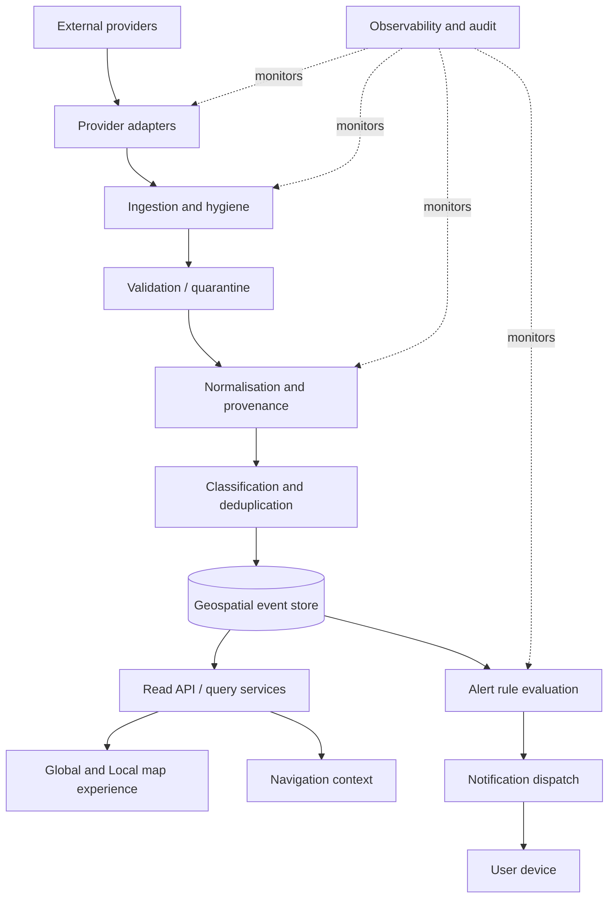

# BASTION-KERN system overview

**Document status:** Reference architecture  
**Implementation status:** Not independently verified by this document  
**Scope:** Logical architecture for geospatial event ingestion, interpretation, presentation, and notification.

## 1. System objectives

BASTION-KERN is intended to help users understand relevant events in geographic context. The system must preserve source provenance, make uncertainty visible, separate global context from local incidents, and avoid representing unavailable or stale information as live.

The architecture is a target model. Components are not considered deployed until their code, configuration, and operational checks have been inspected.

## 2. Logical data flow

## 3. Component responsibilities

| Component | Responsibility | Required evidence |
|---|---|---|
| Provider adapter | Fetch and parse one provider's records | Provider contract, tests, attribution |
| Ingestion/hygiene | Validate payload shape, timestamps, limits, and duplicates | Reproducible ingestion tests |
| Quarantine | Isolate malformed, ambiguous, or unsupported records | Quarantine reason and audit trail |
| Normalisation | Convert provider-specific records to canonical event fields | Schema validation and mapping tests |
| Provenance | Retain provider, source ID, URL, times, and transformation history | Inspectable event lineage |
| Classification | Assign category/severity without hiding source confidence | Versioned rules and evaluation tests |
| Geospatial store | Persist geometry and spatial metadata | Database schema, indexes, access controls |
| Read API | Expose only authorised, minimised data | API contract, auth and access tests |
| Client | Render map context and event state | UI tests, accessibility and performance checks |
| Alert engine | Evaluate configured rules and deduplicate dispatch | Replayable rule tests and audit log |
| Observability | Record system health without leaking secrets or sensitive location | Retention policy and access controls |

## 4. Product domains

- **GLOBAL:** world and regional event context.
- **LOCAL:** events relevant to the user's selected or permitted area.
- **NAVIGATION:** route planning and travel context; it is a distinct module.

A global event may affect a local area only when an explicit impact geometry or documented spatial rule supports that relationship. A local incident must not automatically become a global event.

## 5. Event state is multidimensional

Do not collapse these fields into one status or colour:

- **Severity:** estimated consequence or intensity.
- **Verification:** verified, corroborated, preliminary, or unconfirmed.
- **Confidence:** quality of the evidence and classification.
- **Freshness:** age of the source observation and last successful update.
- **Lifecycle:** active, updated, resolved, or withdrawn.
- **Availability:** live, delayed, or unavailable.

A severe but unverified report must remain visibly unverified. A verified old event must not be labelled live.

## 6. Geospatial contract

- Interchange geometries use RFC 7946 GeoJSON.
- GeoJSON positions are `[longitude, latitude]` in decimal degrees.
- The source CRS and source axis order must be established before transformation.
- Preserve source geometry and transformation metadata when lawful and operationally appropriate.
- Validate geometry type, coordinate ranges, topology where relevant, and bounding boxes.
- Never infer impact polygons from a point location without a documented model.

See [the coordinate reference system contract](../geospatial/coordinate-reference-systems.md).

## 7. Resilience and failure behaviour

- One provider failure must not blank the application.
- Record provider health, last successful fetch, and data freshness.
- Apply bounded retries, exponential backoff, rate-limit handling, and request timeouts.
- Quarantine malformed records rather than silently coercing them.
- Preserve a clear delayed/unavailable state when upstream data cannot be refreshed.
- Prevent duplicate alerts through stable event identity and idempotency keys.
- Make notification dispatch observable and replay-safe.

## 8. Security boundaries

Treat provider responses, news text, user submissions, and external links as untrusted input. Validate at ingestion and again at API boundaries. Keep provider credentials server-side. Use least-privilege database roles and row-level security for exposed Supabase schemas. Do not use user-editable profile metadata as an authorisation source.

## 9. Non-functional requirements

- **Performance:** viewport-aware loading, clustering, cancellation, and bounded rendering work.
- **Availability:** graceful degradation when an upstream provider is delayed or unavailable.
- **Auditability:** versioned schemas, classification rules, and source mappings.
- **Accessibility:** semantic controls, readable contrast, keyboard/VoiceOver support, reduced motion.
- **Privacy:** data minimisation, explicit purpose, retention limits, and access logging.
- **Interoperability:** stable schemas, UTC timestamps, documented CRS, and versioned APIs.

## 10. Architecture decision records

Material choices should be recorded under `docs/architecture/decisions/` using:

- Context and problem.
- Options considered.
- Decision and rationale.
- Consequences and risks.
- Status: proposed, accepted, superseded.
- Date and reviewers.

Do not introduce a second map engine, duplicate geospatial canvas, or a new cloud dependency without an explicit architecture decision.
